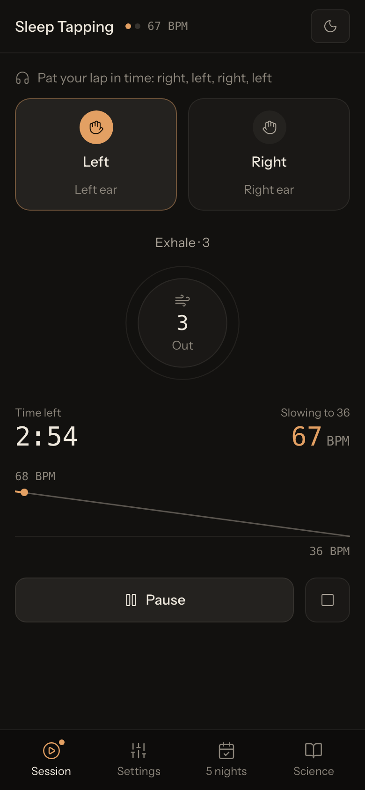

# Sleep Tapping



Sleep Tapping plays a left-right tapping rhythm that slows from 68 to 36 BPM while you pat your lap and breathe in time. Jim Donovan describes the method in his TEDxYoungstown talk "How to trick your brain into falling asleep". The app runs in the browser at https://snowfluke.github.io/sleep-tapping/.

## How to use

1. Sit on the edge of your bed and rest your hands on your lap. Headphones help you hear the taps move between your ears.
2. Pick a length on the Session tab. The 3-minute session matches the challenge in the talk.
3. Press **Start tapping** and pat your lap with each tap: right, left, right, left. Breathe with the ring.
4. As the rhythm slows, slow your hands with it. Lie back when you feel drowsy.

Tap the moon button for nightstand mode. It turns the screen black with dim amber text, and the sound and vibration keep running.

## Features

- **Tempo curve.** Choose a continuous slowdown, three stages or a late start, and watch your place on the curve during a session.
- **Six tap sounds** generated with the Web Audio API, from a lap drum to a singing bowl, with optional stereo panning.
- **Breathing guide** for 4-4, 4-7-8 or box breathing.
- **Background sound**: brown noise, pink noise, rain or crickets.
- **Vibration** on each beat, on phones whose browser supports the Vibration API.
- **5-night challenge** with a sleep journal. Your settings and journal stay in your browser's local storage.

## Development

You need [Bun](https://bun.sh).

```bash
bun install
bun run dev      # http://localhost:3000
bun run lint     # type-check
bun run test     # unit tests
bun run build    # production build in dist/
```

## Deployment

Every push to `main` builds the app and publishes it to GitHub Pages. Each pull request gets a preview at `/pull/<number>/`, and a bot comments the link on the PR. The workflows push the site to the `gh-pages` branch, so set **Settings → Pages → Source** to **GitHub Actions** once.

## Disclaimer

Sleep Tapping is not medical advice and has not been tested as a sleep treatment. The project has no affiliation with Jim Donovan, TEDx or BrainTap, Inc. If you often have trouble sleeping, talk to a doctor.

## License

[MIT](LICENSE)
